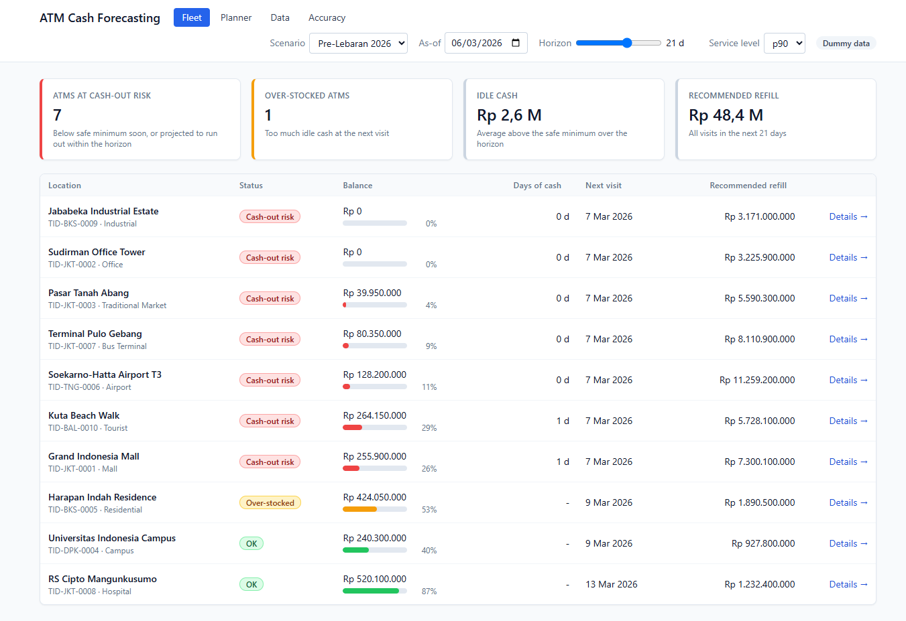

# ATM Cash Forecasting & Replenishment Demo

A local web demo that forecasts daily cash withdrawals for each ATM (TID) and recommends **when** and **how much** to refill it. When the cash budget is limited, it moves money from ATMs that will be over-stocked to ATMs that will run out ("cross-subsidy"). It runs entirely on one laptop (no login, no cloud, works offline after the first install) and ships with a two-year dummy dataset for 10 ATMs that includes Lebaran, New Year and other Indonesian holidays.



- **User manual (Bahasa Indonesia):** [`docs/manual-book.html`](docs/manual-book.html). Open it in a browser.
- **Specs:** [`docs/PRD.md`](docs/PRD.md) (what and why), [`docs/ARCHITECTURE.md`](docs/ARCHITECTURE.md) (how), [`docs/TRD.md`](docs/TRD.md) (exact technical requirements).

## Quick start (Windows)

Requirements: **Python 3.13** and **Node.js 24** (npm). The first run needs internet for `pip` and `npm`.

```powershell
cd D:\Training
powershell -ExecutionPolicy Bypass -File scripts\run.ps1
```

On the first run, `run.ps1`:

1. Creates `backend\.venv` and installs the backend.
2. Builds the frontend (`frontend\dist`) whenever it is missing or older than the sources.
3. Starts the server on **http://127.0.0.1:8000** and opens the browser.

The app opens on the **Pre-Lebaran 2026** scenario. The first forecast for all 10 ATMs takes about 20–30 s, and the header shows `Forecasting x/10` until it finishes. Results are cached, so later visits are instant.

| Option | Command |
|---|---|
| Don't open a browser | `scripts\run.ps1 -NoBrowser` |
| Use another port | `$env:CASHFC_PORT=8080; scripts\run.ps1` |
| Stop | `Ctrl+C` in the PowerShell window |
| Back to the dummy data | **Data** page → **Reset to dummy data** |

Tip for a client meeting: run the app once beforehand so everything is installed and the demo scenarios are cached. After that the demo needs no network; it only ever talks to `127.0.0.1`.

## What it does

| Screen | Purpose |
|---|---|
| **Fleet** | Every ATM with its balance, status (*Cash-out risk*, *Over-stocked*, *OK*), days of cash left, next visit and recommended refill. |
| **ATM detail** | Withdrawal history and forecast (p50 with a p10–p90 band; Lebaran shaded), the balance under the current policy vs the recommended plan, and the visit-by-visit recommendation with reasons. |
| **Planner** | Enter a budget and see how it is split across ATMs. Shows which visits are underfunded and where the cash was re-allocated (Sankey), compares the current policy with the recommendation, and lets you edit, skip or move visits manually and export the plan as CSV. |
| **Data** | Upload your own daily log, ATM master or holiday calendar (CSV or `.xlsx`), edit rows, and validate the data. Forecasts recompute automatically. |
| **Accuracy** | Rolling-origin backtest per ATM: model, WAPE, MAPE, MAE, interval coverage, and the comparison with a seasonal-naive baseline. |

**Forecasting.** For each ATM, the engine compares three statistical models (seasonal naive, Holt-Winters/ETS, and SARIMAX with Indonesian calendar regressors such as Lebaran, payday and year-end) and picks the one with the lowest backtest WAPE. Days on which an ATM ran empty are treated as censored, so the model is not taught to under-forecast peaks.

## Using your own data

Upload on the **Data** page. One row per ATM per day:

| Column | Required | Accepted header aliases |
|---|---|---|
| `tid` | yes | `terminal_id`, `atm_id`, `id_atm` |
| `date` | yes | `tanggal`, `tgl`, `log_date` (formats `YYYY-MM-DD`, `DD/MM/YYYY`, `DD-MM-YYYY`) |
| `opening_balance` | yes | `saldo_awal`, `open_balance` |
| `closing_balance` | yes | `saldo_akhir`, `close_balance`, `end_balance` |
| `withdrawal` | no* | `penarikan`, `tarik_tunai`, `cash_out` |
| `replenishment` | no* | `isi_ulang`, `pengisian`, `cash_in`, `refill` |

\* If a column or a cell is blank, the value is derived from the balance change. A sudden jump in balance is treated as a replenishment.

Notes:

- The delimiter can be `,` or `;`, and an `Rp` prefix is allowed.
- Amounts with thousand separators such as `1.000.000` are rejected per row, because they are ambiguous. Use plain digits or an `.xlsx` file.
- An ATM needs at least **280 days** of history to be forecast.
- Unknown TIDs get an inferred master row, flagged for review.

The full rules are in [`docs/PRD.md`](docs/PRD.md) §4 and [`docs/TRD.md`](docs/TRD.md) §3–4.

## Project layout

```
backend/engine/   pure-Python forecasting and planning (no I/O): ingest, validate, models, backtest, forecast, plan, allocate, compare
backend/app/      FastAPI app: SQLite workspace store, process-pool job runner, services, routes; serves the built SPA
backend/tests/    pytest (engine, api, perf)
frontend/         React + Vite + TypeScript (TanStack Query, Zustand, ECharts, AG Grid, Tailwind), Vitest + Playwright
data/             dummy dataset + generator (stdlib only, seeded, reproducible)
scripts/          run.ps1 (demo), dev.ps1 (development)
docs/             PRD, architecture, TRD, implementation plan, user manual
workspace/        runtime SQLite database (git-ignored, created on first run)
```

## Development

```powershell
scripts\dev.ps1                      # backend with --reload on :8000 + Vite dev server on :5173

cd backend
.\.venv\Scripts\Activate.ps1
pytest                               # fast suite (excludes slow and perf)
pytest -m slow                       # golden accuracy tests on the dummy data
pytest -m perf                       # timing tests
ruff check . ; ruff format --check .

cd ..\frontend
npm run lint
npm test                             # Vitest
npm run build
npx playwright install chromium      # once
npm run e2e                          # build + Playwright smoke tests on a temporary workspace
npm run gen:api                      # regenerate API types from a backend running on :8000

python data\generate_dummy.py        # regenerate the dummy CSVs (byte-for-byte reproducible)
```

Settings can be overridden with environment variables prefixed `CASHFC_`, for example `CASHFC_PORT`, `CASHFC_WORKSPACE_DB`, `CASHFC_WORKERS` and `CASHFC_WARMUP_SCENARIOS` (see `backend/app/settings.py`).

## Known limitations

- The dummy data is synthetic. The 2026 Islamic holiday dates are approximate, so check them against the official SKB before a client demo.
- At service level p90, the recommendation strongly reduces cash-out days, but it uses more visits and fleet-wide idle cash than the current policy. Use p80 if cost matters more.
- An edit to the data refits only the affected ATM, reusing its previous model. Its accuracy row is marked *stale* until the as-of date changes or the data is reset.
- Saving manual edits in the Planner can drop manual overrides of an ATM that is still being recomputed at that moment.
